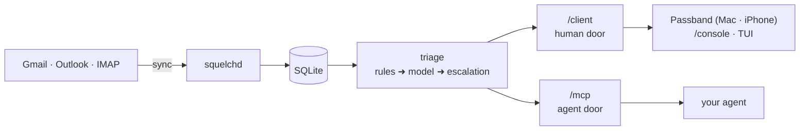

<div align="center">

<picture>
  <source media="(prefers-color-scheme: dark)" srcset="brand/png/icon-dark-256.png">
  
</picture>

# Passband

**Know what needs you.**

An email client for Mac and iPhone that reads every message as it arrives, pulls forward the few that need you, and files the rest where you can find them. Open source, and built to run on your own box.

[](https://github.com/passband-app/passband/actions/workflows/release-daemon.yml)
[](LICENSE)
[](Cargo.toml)
[](deploy/DOCKER.md)

[Self-host](#self-host-it) ·
[Agents](#your-agent-gets-an-mcp) ·
[How it works](#how-it-works) ·
[Security](#security) ·
[Build from source](#build-from-source) ·
[Docs](#docs)

[passband.app](https://passband.app) · [Trust](https://passband.app/trust) · [Threat model](docs/SECURITY.md)

</div>

---

Inbox zero every day was never realistic. Passband doesn't ask you to get there. Every email still arrives; Passband reads each one, works out what it means for you (a deadline, a package, a person waiting on a reply) and only interrupts you for the handful that actually need you.

It comes in two pieces:

- **`squelchd`**, a Rust daemon that syncs your mailbox, triages every message, and serves the result over two doors: one for your own apps, one for AI agents.
- **Passband**, the native Mac and iPhone app you read it in.

The names come from radio. A squelch mutes everything below a signal threshold; the passband is the band a filter lets through. Your inbox is what made it through.

## What it does

|     |     |
| --- | --- |
| 🧭 **The sitrep** | Opens on one sentence about your day, then the few things that need you, each with what it wants. The rest is filed, not deleted. |
| ⏩ **Flow mode** | Press <kbd>space</kbd> and move through what needs you, one email after the next, until the board is clear. |
| 🗂️ **Smart grouping** | Packages, bills, receipts and invitations are gathered into their own cards, with deadlines and tracking pulled out. |
| 🔑 **Login codes come to you** | A sign-in code floats over whatever app you're in. Copy it without opening your inbox. Agents and the assistant never see one. |
| ✂️ **Unsubscribe that works** | Passband notices senders you've stopped reading and offers to cut them loose. Press <kbd>u</kbd> and it handles the rest, forms included. |
| 💬 **Rules in plain English** | "Only tell me about school closures" is a rule. Your words go to the triage model verbatim. |
| 📅 **Your inbox knows your plans** | Invitations, tickets and bookings land on a calendar with how likely you are to go, and stay current as the mail about them changes. |
| 🤖 **An assistant inside the app** | Searches and summarizes your mailbox, and parks every action on a confirm card before it touches anything. |
| 🔌 **An MCP for your agent** | Pre-triaged mail for the agent you already run. It never holds your mail credential and never sees a login code. |

## Two ways to run it

**Self-host** the daemon on your own machine, NAS, or server. Your mail, your search index and your provider tokens stay on your disk. Everything the hosted version does, self-host does too. That's what the rest of this README is about.

**Hosted** is the same daemon run for you, one isolated instance per account, which is what makes always-on triage and phone push painless. It's in invite-only alpha: [join the waitlist](https://passband.app). Where hosted mail goes, every wire of it, is on the [trust page](https://passband.app/trust).

Either way the app is the same app. It only ever knows a URL and a token.

## Self-host it

You need Docker on an always-on box (amd64 or arm64), a Mac, and the mailbox you want triaged. Budget about 30 minutes, most of it in the Google Cloud console.

> [!TIP]
> This is the short path. [**docs/GETTING-STARTED.md**](docs/GETTING-STARTED.md) walks the same setup end to end (daemon on a NAS, Passband on a Mac) with a troubleshooting table, and [deploy/DOCKER.md](deploy/DOCKER.md) is the full image and compose reference.

### 1. Create a Google OAuth client

Your daemon talks to Gmail as an app *you* own, so we are never in the loop.

1. In [console.cloud.google.com](https://console.cloud.google.com), create a project.
2. Enable the **Gmail API**.
3. Configure the OAuth consent screen (External) and add yourself as a test user. Then publish it to **In production**: a consent screen left in Testing expires refresh tokens every 7 days.
4. Create credentials: **OAuth client ID**, type **Desktop app**.

Using Outlook or IMAP instead? Skip this step and see [Other mail providers](#other-mail-providers).

### 2. Run the daemon

Images are public on GHCR, no registry login needed. A `docker-compose.yml`:

```yaml
x-squelch-env: &squelch-env
  SQUELCH_ACCOUNT_EMAIL: you@gmail.com
  SQUELCH_CLIENT_ID: ${SQUELCH_CLIENT_ID:?set in .env}
  SQUELCH_CLIENT_SECRET: ${SQUELCH_CLIENT_SECRET:?set in .env}
  # Optional: turns on model triage and the in-app assistant.
  ANTHROPIC_API_KEY: ${ANTHROPIC_API_KEY:-}

services:
  squelchd:
    image: ghcr.io/passband-app/squelchd:latest
    restart: unless-stopped
    ports:
      - "127.0.0.1:8848:8848"   # loopback; see "Reaching it" below
    volumes:
      - squelch-data:/data
    environment: *squelch-env

  # One-off OAuth consent. Never started by `up`.
  auth:
    image: ghcr.io/passband-app/squelchd:latest
    profiles: ["auth"]
    network_mode: host
    volumes:
      - squelch-data:/data
    environment: *squelch-env
    command: auth --headless --port 8847

volumes:
  squelch-data:
```

And a `.env` beside it (`chmod 600 .env`):

```ini
SQUELCH_CLIENT_ID=<your client id>
SQUELCH_CLIENT_SECRET=<your client secret>
ANTHROPIC_API_KEY=<optional>
```

Everything lives in the one `/data` volume: the SQLite database, the credentials, and a small embedding model downloaded on first run.

### 3. Authorize your mailbox

From your laptop, forward the consent port to the box, then run the auth service there:

```sh
ssh -L 8847:127.0.0.1:8847 yourbox     # on your laptop
docker compose run --rm auth           # on the box, inside that session
docker compose up -d squelchd
```

Open the printed `accounts.google.com` link in your laptop's browser; the redirect tunnels back to the box. Google will say it hasn't verified the app. It's your app, so continue.

<details>
<summary><b>No SSH to the box?</b> Consent on your laptop, then import</summary>

```sh
# on a machine with a browser (same SQUELCH_CLIENT_ID / SECRET):
squelchd auth --export --out cred.txt

# on the daemon's host:
docker compose run --rm -T squelchd auth --import < cred.txt
rm cred.txt
```

`--out` writes the file mode 0600, because it is a live refresh token. `--import` reads stdin only, and before storing anything it asks Google which mailbox the token opens and refuses one that doesn't match. A refresh token is bound to the OAuth client that minted it, so both machines must use the same client. [GETTING-STARTED §3](docs/GETTING-STARTED.md#3-authorize-gmail) has the details, including running the export from the container image itself.

</details>

One consent covers everything. Passband asks Google for a single Gmail scope, `gmail.modify`, and the daemon keeps sync and your write actions on separate credential slots ([why](#security)).

### 4. Get the app and pair it

```sh
brew install --cask passband-app/tap/passband
```

or download it from [passband.app](https://passband.app). It's signed, notarized, and updates itself. Then mint a one-time pairing code on the box:

```sh
docker compose exec -u squelch squelchd squelchd pair --url https://<what your Mac can reach>
```

Open the `passband://pair?...` link it prints, or type the `XXXX-XXXX` code into the app's first screen. The code works once, for ten minutes. Each device gets its own token: `squelchd token list` shows them and `squelchd token revoke <id>` kills one.

> [!NOTE]
> Prefer a single shared password? Set `SQUELCH_API_TOKEN` (`openssl rand -hex 32`, generated once into `.env`) and paste it into the app instead. It survives revoking every device, which is also why it's optional.

### Reaching it

The compose file binds loopback on purpose. The easy way to reach it from your Mac and phone, with TLS, is Tailscale:

```sh
tailscale serve --bg 8848
```

and use `https://<box>.<tailnet>.ts.net` as the server URL. Exposing `8848:8848` on a trusted LAN also works, but the bearer token then travels in plain HTTP.

### What reaches us when you self-host

Nothing, unless you turn it on. Push notifications to your phone go through our relay and carry a fixed alert and an event id, never mail content. Read receipts on mail you send are off by default and opt-in per message. Triage and the assistant use **your** Anthropic or OpenAI key under your own account; with no key, triage runs on local rules and no mail leaves the box.

### Upgrades

```sh
docker compose pull && docker compose up -d squelchd
```

`latest` tracks the newest `daemon-X.Y.Z` tag. Pin `ghcr.io/passband-app/squelchd:daemon-X.Y.Z` if you'd rather upgrades be deliberate. The Mac app updates itself.

## Configuring it

Configuration is environment variables, plus an optional `~/.config/squelch/config.toml` (inside the container, `/data/.config/squelch/config.toml`). The ones you're likely to touch:

| Variable | What it does |
|---|---|
| `ANTHROPIC_API_KEY` / `OPENAI_API_KEY` | Turns on model triage and the assistant. Without one, triage runs on heuristics and rules. |
| `SQUELCH_MCP_ALLOWED_HOSTS` | Hostnames the agent door accepts. **Required behind `tailscale serve` or any proxy**, or `/mcp` returns 403. |
| `SQUELCH_API_TOKEN` | Optional master bearer for the human door. Omit it and pair devices instead. |
| `SQUELCH_FEATURES=calendar` | Turns on the Calendar page and Google Calendar sync. Connect it from the app, or `squelchd auth --calendar`. |
| `SQUELCH_METRICS_BIND` | Opens a second listener with Prometheus `/metrics` and `/healthz`. Unauthenticated by design: bind it to loopback or a private interface, never a public one. |
| `SQUELCH_POLL_SECS` | How often the mailbox is polled. Default 5. |

Model triage has daily spend caps on by default, adjustable from the app's Settings without a restart. Models, prices and budgets live under `[stage1]` / `[stage2]` in the config file. The complete table is in [deploy/DEPLOY.md](deploy/DEPLOY.md#environment-variables), and [docs/TRIAGE-OPERATIONS.md](docs/TRIAGE-OPERATIONS.md) covers the metrics worth watching.

### Other mail providers

| Provider | Setup | Notes |
|---|---|---|
| **Gmail** | The steps above. | Calendar sync and the full feature set. |
| **Outlook** (Outlook.com, Hotmail, Microsoft 365) | Put `provider = "outlook"` in the config file and run `squelchd auth`. No Google client needed; the build ships its own Entra app. | No calendar view yet. Bring your own Entra app if your work tenant blocks unverified ones. |
| **IMAP** | `squelchd auth --imap` prompts for the server, TLS mode and an app password, and tests the login before storing anything. | Self-host only, and the newest of the three. |

One daemon is one mailbox. Several mailboxes are several daemons; the app keeps a list of them and switches with ⌘1 to ⌘9. Details in [GETTING-STARTED](docs/GETTING-STARTED.md#outlook-instead-of-gmail) and [MAIL-PROVIDERS](docs/MAIL-PROVIDERS.md).

### Other ways to look at it

- **`/console`**: your daemon serves a small web console at `http://<box>:8848/console` for seeing what the mailbox is doing and managing paired devices. Server-rendered, no JavaScript. Sign in with a `squelchd pair` code.
- **`squelch-tui`**: a terminal view on the box itself, for setup and debugging.
- **No Docker?** [deploy/DEPLOY.md](deploy/DEPLOY.md) is the bare-metal runbook: a release build, a service user, and a systemd unit.

## Your agent gets an MCP

Point any MCP client at the daemon's streamable HTTP endpoint:

```json
{
  "mcpServers": {
    "passband": { "type": "http", "url": "https://<box>.<tailnet>.ts.net/mcp" }
  }
}
```

(Or `http://127.0.0.1:8848/mcp` on the same machine. Remember `SQUELCH_MCP_ALLOWED_HOSTS` for anything that isn't localhost.)

| Tool | What it returns |
|---|---|
| `get_inbox_updates` | ranked updates since a timestamp, each with a one-line "why" and any rule you wrote for that sender |
| `get_reading` | newsletters and longer reads triage set aside |
| `get_thread` | a full thread, as text |
| `search_mail` | full-text and semantic search over synced mail |
| `search_calendar` | events on your calendar, plus bookings found in mail that aren't on it yet |
| `get_deadlines` | bills and deadlines extracted during triage |
| `get_shipments` | packages in transit |
| `set_sender_rule` / `list_sender_rules` | squelch, surface or filter a sender, in your own words |
| `create_draft` / `open_draft` | leave a draft in Passband for you to read and send |
| `send_email` | only if you allow it, and only with your approval per message |

What the agent may write is your call, per mailbox, in the app under Settings > Agents: **Read only**, **Drafts only** (the default), or **Send, with your approval**. The agent never holds your mail credential, never sees HTML, spam, or a login code, and anything it sends runs through the same guarded, audited pipeline yours does. More in [squelch-mcp/README.md](squelch-mcp/README.md).

## How it works



- **Sync** pulls new mail every few seconds. Mail you've sent seeds a "people I know" list, the strongest cheap signal there is: someone you write to always gets through.
- **Triage** starts with what needs no model: your sender rules, and the login codes and password resets rules can recognize, which are sealed on the spot. Every message then gets a model verdict (importance, tier, deadline, a one-line summary, and the reason for each), and a router sends the uncertain ones back for a second look with more context: the sender's history, the rest of the thread, your past corrections. Escalation buys information, not a bigger model.
- **Re-triage**: relevance expires. Anything with a deadline schedules its own second look, the model can name dates to look again, and verdicts you've corrected by hand are never overridden.
- **Two doors.** Your apps use `/client`: authenticated per device, with search, threads, rules and the gated actions (archive, label, send). Agents use `/mcp`: ranked text, no mailbox writes unless you allow them, and no sealed mail, ever.

The deeper story is in [docs/TRIAGE-CODE-DESIGN.md](docs/TRIAGE-CODE-DESIGN.md) and [docs/TRIAGE-OPERATIONS.md](docs/TRIAGE-OPERATIONS.md).

## Security

- **Sync never writes.** Google grants one Gmail permission that can both read and write, so the daemon separates them in code: sync and triage load their own credential slot and contain no code that archives, labels or sends. Writes happen only in the human door's action handlers, which require an explicit confirm, scan outgoing mail for secrets, and audit every attempt.
- **Login codes are sealed.** Verification codes, sign-in links and password resets are recognized by rules first and triage second. A message with no current verdict is withheld by default, so they never reach an agent or the in-app assistant. You see them; your AI tools don't.
- **Mail is untrusted input everywhere.** HTML is sanitized on arrival and rendered with scripts off, navigation blocked, images proxied without cookies or referrer, and tracking pixels stripped from senders you've never written to. Spam is never triaged or shown to a model.
- **Agents draft, you send.** The agent door serves text only, and sending is off unless you turn it on.
- **Nothing is trained on your mail.** Not by us, and not by the model provider.

The full model, one section per surface with the exact line that enforces each rule, is [docs/SECURITY.md](docs/SECURITY.md). Report vulnerabilities to braelyn@passband.app; we acknowledge within 72 hours.

## Build from source

You don't need to for self-hosting; the image and the signed app cover that. This is for working on it.

**The daemon** (Rust, stable toolchain):

```sh
cargo run --bin squelchd -- auth     # one-time consent; macOS keychain, or a 0600 file on Linux
cargo run --bin squelchd -- serve    # sync + both doors on 127.0.0.1:8848
cargo run --bin squelch-tui
```

With the same `SQUELCH_*` variables as above in your environment. To build the container yourself: `docker build -f squelchd/Dockerfile -t squelchd .` (note the `-f`: the repo-root Dockerfile builds the push relay, not the daemon).

**Passband** (Swift):

```sh
cd passband
./build.sh run          # build and launch the Mac app (no Xcode needed)
./build.sh release      # optimized
```

The iOS target needs Xcode: `xcodegen generate`, then build `PassbandiOS`.

<details>
<summary><b>Code signing notes</b> (why local builds want a Developer ID cert)</summary>

Local builds sign with whatever `Developer ID Application` certificate is in the keychain, falling back to ad-hoc when there is none. Keychain ACLs match on a bundle's *designated requirement*, and an ad-hoc signature's requirement is a hash of the build itself, so every recompile looks like a new app and re-prompts for access to the stored credentials. A Developer ID requirement is keyed to the team and stays constant across rebuilds. Local builds also get `get-task-allow` so a debugger can attach; it is injected into a throwaway copy of the entitlements and never reaches a release.

`VERSION` holds the user-facing version; the build number is the git commit count. Override either with `MARKETING_VERSION=` / `BUILD_NUMBER=`.

</details>

<details>
<summary><b>Releases</b> (a tag, and CI does the rest)</summary>

Each surface releases from its own tag namespace: `daemon-X.Y.Z` publishes the GHCR image, `passband-mac-X.Y.Z` builds, signs, notarizes, staples, publishes the appcast and bumps the Homebrew cask, and `passband-ios-X.Y.Z` ships to TestFlight. The prerequisites, secrets, and what to do about a bad release: [passband/RELEASING.md](passband/RELEASING.md) and [docs/RELEASING.md](docs/RELEASING.md).

</details>

### Workspace layout

| Component | What it is |
|---|---|
| [`squelchd`](squelchd/README.md) | the daemon binary: `auth`, `serve`, `pair`, `token` |
| `squelch-core` | store, sync, mail providers, triage, extraction, calendar |
| [`squelch-api`](squelch-api/README.md) | the human door (`/client`) and the `/console` pages |
| [`squelch-mcp`](squelch-mcp/README.md) | the agent door (`/mcp`) |
| `squelch-httpauth`, `squelch-ratelimit` | shared auth and rate limiting for the doors |
| [`squelch-tui`](squelch-tui/README.md) | terminal viewer for setup and debugging |
| `squelch-embed` | the shared embedding service (hosted) |
| `passband` | the Mac and iPhone app, one source tree |
| `passband-site` | [passband.app](https://passband.app) |
| [`squelch-relay`](squelch-relay/README.md) | blind push and read-receipt relay |
| [`squelch-control`](squelch-control/README.md), [`squelch-warden`](squelch-warden/README.md) | hosted only: signup, and the provisioner that runs one daemon per account |
| [`squelch-broker`](squelch-broker/README.md) | consent relay; built, not deployed ([why](docs/BROKER.md)) |
| `squelch-eval`, `evals` | triage evals |

## Docs

| Doc | Covers |
|---|---|
| [GETTING-STARTED.md](docs/GETTING-STARTED.md) | the full self-host walkthrough, with troubleshooting |
| [deploy/DOCKER.md](deploy/DOCKER.md) | the image, compose file, pairing, upgrades |
| [deploy/DEPLOY.md](deploy/DEPLOY.md) | bare metal on Linux, and the complete environment variable table |
| [MAIL-PROVIDERS.md](docs/MAIL-PROVIDERS.md) | Gmail, Outlook and IMAP |
| [SECURITY.md](docs/SECURITY.md) | the threat model |
| [CALENDAR.md](docs/CALENDAR.md) | the calendar: events from mail, and Google Calendar sync |
| [SHIPMENTS.md](docs/SHIPMENTS.md) | package tracking, and bringing your own carrier keys |
| [TRACKING.md](docs/TRACKING.md) | opt-in read receipts |
| [TRIAGE-OPERATIONS.md](docs/TRIAGE-OPERATIONS.md) | how triage runs, and what to watch |
| [HOSTED.md](docs/HOSTED.md) | the hosted tier, and what self-host keeps |
| [RELEASING.md](docs/RELEASING.md) | the release surfaces and their tags |
| [CHANGELOG.md](docs/CHANGELOG.md) | what changed |

## License

[MIT](LICENSE) © Braelyn Boynton. Daemon and apps alike.
