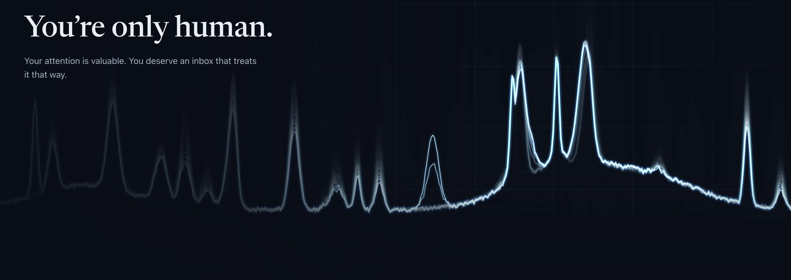
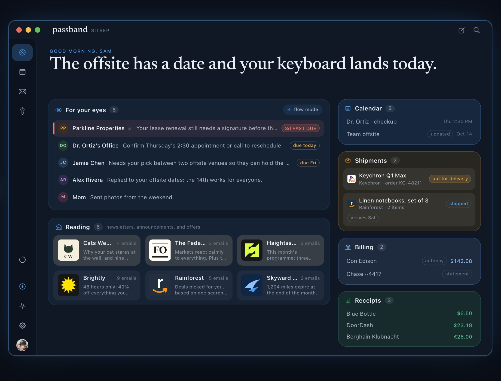
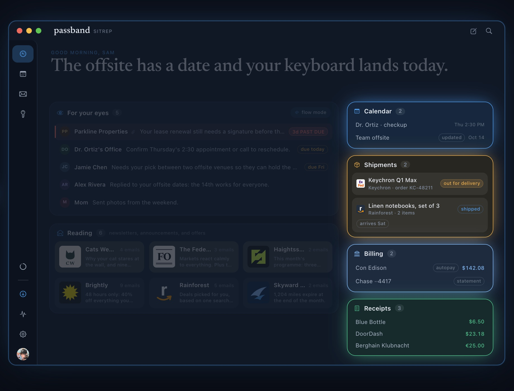
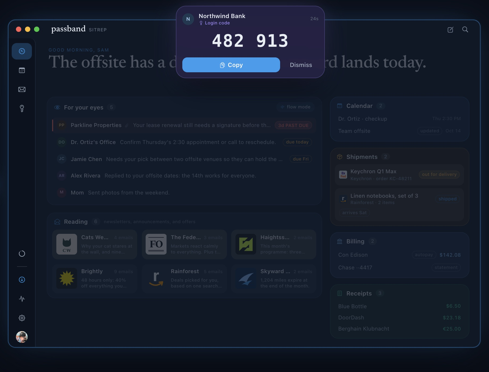
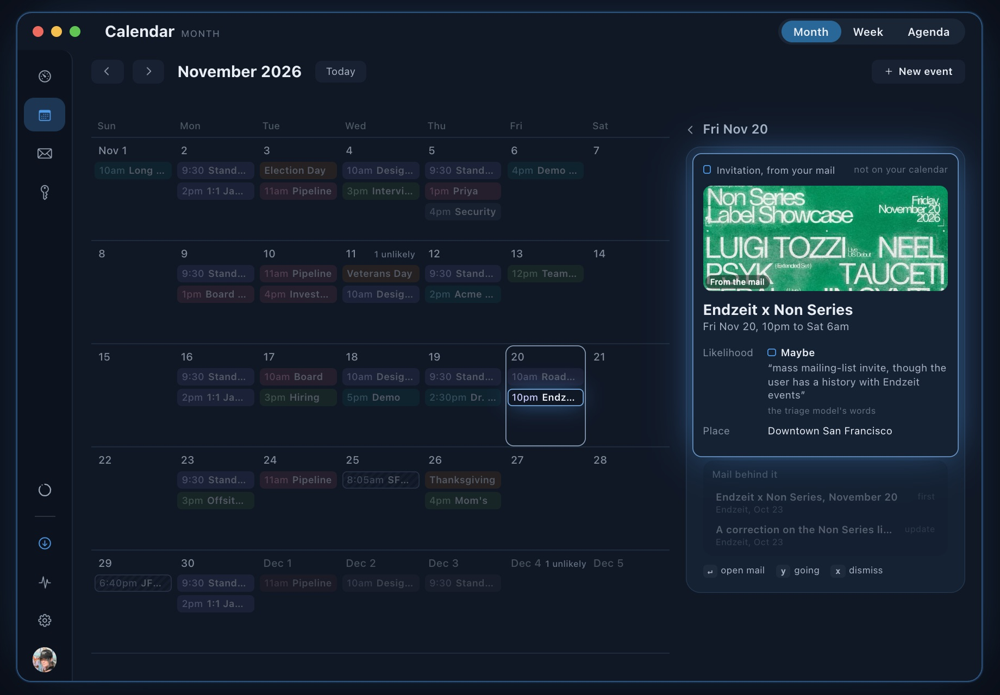
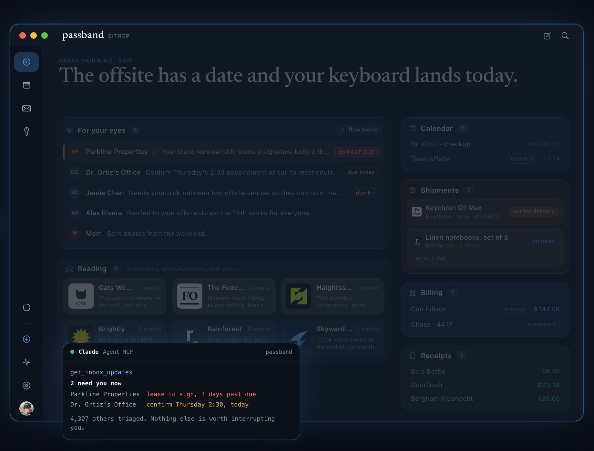
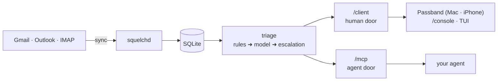

<div align="center">



# Passband

**Know what needs you.**

An email client for Mac and iPhone that reads every message as it arrives, pulls forward the few that need you, and files the rest. Open source, and built to run on your own box.

[](https://github.com/passband-app/passband/actions/workflows/release-daemon.yml)
[](LICENSE)
[](Cargo.toml)
[](deploy/DOCKER.md)

[**Self-host it**](#self-host-it) · [Agents](#your-agent-gets-an-mcp) · [How it works](#how-it-works) · [Security](#security) · [Docs](#docs) · [passband.app](https://passband.app)

</div>

---

Inbox zero every day was never realistic. Passband doesn't ask you to get there. Every email still arrives; Passband works out what each one means for you (a deadline, a package, a person waiting on a reply) and only interrupts you for the handful that actually need you.

<p align="center">
  
</p>

It comes in two pieces: **`squelchd`**, a Rust daemon that syncs your mailbox, triages every message and serves the results, and **Passband**, the native app you read it in. The names come from radio: a squelch mutes everything below a threshold, and the passband is the band a filter lets through.

## What it does

<table>
<tr>
<td width="50%" valign="top">

<h4>Smart grouping</h4>
Packages, bills, receipts and invitations are gathered into their own cards, with deadlines and tracking pulled out.
</td>
<td width="50%" valign="top">

<h4>Login codes come to you</h4>
A sign-in code floats over whatever app you're in. Copy it without opening your inbox. Agents never see one.
</td>
</tr>
<tr>
<td width="50%" valign="top">

<h4>Your inbox knows your plans</h4>
Invitations, tickets and bookings land on a calendar with how likely you are to go, and stay current as the mail changes.
</td>
<td width="50%" valign="top">

<h4>An MCP for your agent</h4>
Pre-triaged mail for the agent you already run. It never holds your mail credential.
</td>
</tr>
</table>

Plus: **flow mode** (<kbd>space</kbd> walks you through what needs you, one email at a time), **unsubscribe that works** (<kbd>u</kbd>, and it handles the sender's form too), **rules in plain English** ("only tell me about school closures"), and a built-in **assistant** that confirms before it touches anything.

## Two ways to run it

|   | **Self-host** | **Hosted** |
|---|---|---|
| Where your mail lives | your disk | an isolated instance we run, one per account |
| Model key | yours (Anthropic or OpenAI), or none | ours |
| Cost | free, MIT licensed | invite-only alpha: [join the waitlist](https://passband.app) |
| Features | everything | everything |

Same daemon, same app. The app only ever knows a URL and a token. Where hosted mail goes is on the [trust page](https://passband.app/trust).

## Self-host it

You need Docker on an always-on box (amd64 or arm64), a Mac, and about 30 minutes, most of it in the Google Cloud console.

> [!TIP]
> **Start with [docs/GETTING-STARTED.md](docs/GETTING-STARTED.md).** It walks the whole thing end to end (daemon on a NAS, Passband on a Mac) and ends with a troubleshooting table.

The short version:

1. **Create a Google OAuth client** (Desktop app type, Gmail API on, consent screen published to *In production*). Your daemon talks to Gmail as an app you own.
2. **Run the daemon** from the public image, `ghcr.io/passband-app/squelchd`, with the [compose file in DOCKER.md](deploy/DOCKER.md#docker-composeyml).
3. **Authorize your mailbox** once: `docker compose run --rm auth` over an SSH tunnel, or consent on your laptop and import ([§3](docs/GETTING-STARTED.md#3-authorize-gmail)).
4. **Install the app** (`brew install --cask passband-app/tap/passband`) and pair it with the code from `squelchd pair`.
5. **Reach it** from your devices, ideally with `tailscale serve --bg 8848` for free TLS.

Add `ANTHROPIC_API_KEY` or `OPENAI_API_KEY` to turn on model triage and the assistant; without one, triage runs on local rules. Every other knob is in the [environment variable table](deploy/DEPLOY.md#environment-variables). No Docker? [deploy/DEPLOY.md](deploy/DEPLOY.md) is the bare-metal and systemd runbook.

**What reaches us when you self-host:** nothing, unless you turn it on. Phone push goes through our relay with a fixed alert and an event id, never mail content. Read receipts are off by default and opt-in per message.

### Mail providers

| | Status | Setup |
|---|---|---|
| **Gmail** | full support | the steps above |
| **Outlook** (Outlook.com, Hotmail, Microsoft 365) | supported; no calendar view yet | `provider = "outlook"` in the config, then `squelchd auth` ([guide](docs/GETTING-STARTED.md#outlook-instead-of-gmail)) |
| **IMAP** (Fastmail, iCloud, Dovecot...) | beta, self-host only; sends over SMTP, set up from the terminal | `squelchd auth --imap` ([details](docs/MAIL-PROVIDERS.md)) |

One daemon is one mailbox; the app switches between several with ⌘1 to ⌘9.

## Your agent gets an MCP

Point any MCP client at your daemon:

```json
{ "mcpServers": { "passband": { "type": "http", "url": "https://<box>.<tailnet>.ts.net/mcp" } } }
```

Set `SQUELCH_MCP_ALLOWED_HOSTS` to that hostname, or `/mcp` answers 403. The agent gets ranked updates with a one-line "why", reading, threads, search, calendar, deadlines, shipments and sender rules. By default it can write drafts and nothing else. You can loosen or tighten that per mailbox under Settings > Agents. It never sees HTML, spam, or a login code. Full tool list: [squelch-mcp/README.md](squelch-mcp/README.md).

## How it works



- **Sync** pulls new mail every few seconds. Anyone you've written to always gets through.
- **Triage** applies your rules first, then gives every message a model verdict (importance, deadline, a one-line summary, and why). Uncertain ones get a second look with more context. Anything with a date schedules its own re-check.
- **Two doors.** Your apps use `/client`: per-device tokens, full mail, gated actions. Agents use `/mcp`: ranked text only. More in [TRIAGE-CODE-DESIGN.md](docs/TRIAGE-CODE-DESIGN.md).

## Security

- **Sync never writes.** The one Gmail permission can read and write, so the daemon splits them in code: sync and triage can't archive, label or send. Writes need an explicit confirm, pass a secret scan, and are audited.
- **Login codes are sealed** from agents and the assistant, by rules first and triage second.
- **Mail is untrusted input.** Sanitized on arrival, rendered with scripts off, images proxied, trackers stripped. Spam never reaches a model.
- **Nothing is trained on your mail**, by us or our model provider.

The full threat model, with the line that enforces each rule: [docs/SECURITY.md](docs/SECURITY.md). Vulnerabilities to braelyn@passband.app (acknowledged within 72 hours).

## Hacking on it

```sh
cargo run --bin squelchd -- serve      # the daemon, on 127.0.0.1:8848
cd passband && ./build.sh run          # the Mac app, no Xcode needed
```

The iOS target needs Xcode (`xcodegen generate`, then `PassbandiOS`). Signing, releases and the tag namespaces are in [passband/RELEASING.md](passband/RELEASING.md) and [docs/RELEASING.md](docs/RELEASING.md).

<details>
<summary><b>Workspace layout</b></summary>

| Component | What it is |
|---|---|
| [`squelchd`](squelchd/README.md) | the daemon binary: `auth`, `serve`, `pair`, `token` |
| `squelch-core` | store, sync, mail providers, triage, extraction, calendar |
| [`squelch-api`](squelch-api/README.md) | the human door (`/client`) and the `/console` pages |
| [`squelch-mcp`](squelch-mcp/README.md) | the agent door (`/mcp`) |
| `squelch-httpauth`, `squelch-ratelimit` | shared auth and rate limiting |
| [`squelch-tui`](squelch-tui/README.md) | terminal viewer for setup and debugging |
| `passband` | the Mac and iPhone app, one source tree |
| `passband-site` | [passband.app](https://passband.app) |
| [`squelch-relay`](squelch-relay/README.md) | blind push and read-receipt relay |
| `squelch-embed` | shared embedding service (hosted) |
| [`squelch-control`](squelch-control/README.md), [`squelch-warden`](squelch-warden/README.md) | hosted only: signup, and the per-account provisioner |
| [`squelch-broker`](squelch-broker/README.md) | consent relay; built, not deployed ([why](docs/BROKER.md)) |
| `squelch-eval`, `evals` | triage evals |

</details>

## Docs

| | |
|---|---|
| **Self-hosting** | [GETTING-STARTED](docs/GETTING-STARTED.md) · [DOCKER](deploy/DOCKER.md) · [DEPLOY](deploy/DEPLOY.md) · [MAIL-PROVIDERS](docs/MAIL-PROVIDERS.md) |
| **Features** | [CALENDAR](docs/CALENDAR.md) · [SHIPMENTS](docs/SHIPMENTS.md) · [TRACKING](docs/TRACKING.md) · [SEARCH](docs/SEARCH.md) |
| **Internals** | [SECURITY](docs/SECURITY.md) · [TRIAGE-OPERATIONS](docs/TRIAGE-OPERATIONS.md) · [HOSTED](docs/HOSTED.md) · [RELEASING](docs/RELEASING.md) · [CHANGELOG](docs/CHANGELOG.md) |

## License

[MIT](LICENSE) © Braelyn Boynton. Daemon and apps alike.
